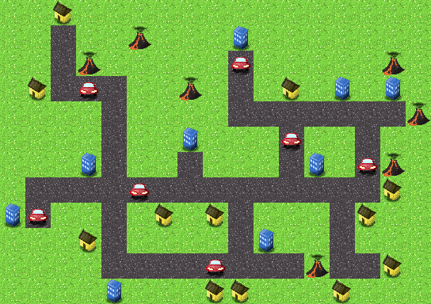

# Urban Planning Assistant with Reinforcement Learning
*Official title: Designing a Traffic System in Urban Planning using Reinforcement Learning*

**National finalist (top 26), 25th National Software Contest (NSC 2023), Thailand** (project 25p23w0004) \
Mahidol Wittayanusorn School (2022 – 2023)



## Description

The user configures the city size, the number of houses and workplaces, and the obstacles (none, random, or
custom). A trained agent builds the city on an empty grid. The app then shows the 3 plans with
the highest traffic flow, with an animation of cars driving through each one.

## Methodology

A custom Gymnasium environment (`src/TownScapeENV.py`) is a 2D grid. Each cell is empty, obstacle,
road, house, or workplace. Agents are trained with PPO (Stable-Baselines3). Traffic flow is the
number of vehicles that pass a reference point per unit of time.

- **Model 1**
  - Action space: `(building type, row, column)`
  - Reward: traffic flow + share of houses whose cars reach a workplace + match with the requested building counts
  - Result: scattered houses, roads not connected: the action space was too large
- **Model 2**
  - Action space: `(row, column)`, built in 3 phases: houses → workplaces → roads
  - Reward: adds zoning (houses and workplaces cluster in separate zones) and a path reward for roads that bring houses closer to workplaces
  - Result: correct building counts, but roads still not one network
- **Model 3**
  - Action space: same phases; roads may only extend an existing road or start from a house
  - Reward: path reward removed: it was costly to compute and slowed learning
  - Result: **one connected road network that meets every requirement. Used in the app.**

## Run

Run all commands from the repo root

```bash
# prerequisite
python -m venv .venv
source .venv/bin/activate                     # Windows: .venv\Scripts\activate
pip install torch --index-url https://download.pytorch.org/whl/cpu   # CPU-only PyTorch (~200 MB)
pip install -r requirements.txt
# run
streamlit run src/app.py
# then open http://localhost:8501 on browser
```

note: Skipping the `torch` line also works, but pulls the CUDA build (several GB). A GPU does not speed
up this project: PPO with a small MLP policy runs best on CPU.

## Train

1. Set city size and iterations: edit `obs_shape` and `train_eps` in `src/ForTrainModel.py`
2. Train: `python src/ForTrainModel.py` -> output in `training/<rows>x<cols>_<train_eps>.zip`
3. Use it in the app: copy the `.zip` to `models/`. The app loads `models/<rows>x<cols>_200.zip`

Verify raw environment is working run: `python src/test.py`

One iteration is 2048 environment steps. The notebooks also need `pip install jupyter tensorboard matplotlib`.

## Layout

- `src/app.py`: Streamlit app
- `src/TownScapeENV.py`: Gymnasium environment (Model 3)
- `src/ForTrainModel.py`: training script
- `src/test.py`: environment smoke test
- `src/assets/`: tile images for rendering
- `models/`: trained models for 5×5, 6×8, 8×8, 10×10, 12×16, after 200 and 1000 iterations
- `training/`: output of new training runs (not tracked by git)
- `notebook/Sketch.ipynb`: development log with an earlier inline version of the environment
- `notebook/Sketch2.ipynb`, `notebook/Train.ipynb`: experiments and training with `src/TownScapeENV.py`
- `notebook/art.ipynb`: draws the city image above
- `legacy/buildEnv.py`: first prototype (needs a `basicClasses` module that is not included)
- `legacy/taxi-v3-practice/`: first RL practice: Q-learning and PPO on Gym Taxi-v3 (Jan 2023)

## Team

- Wachiraphut Intarachart: team leader (concept, RL environment)
- Chitsanuphong Sapyen: developer (document, art, video)
- Burapha Thanataweerat: developer (literature review, training code)
- Dr. Thanatkrit Kaewtem: advisor
- Tossaporn Saengja: advisor
